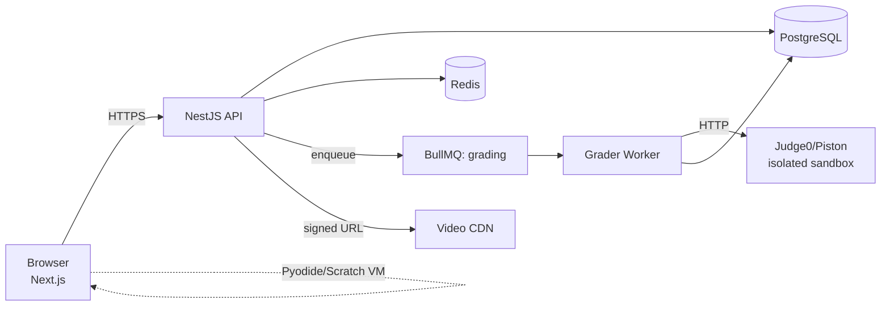
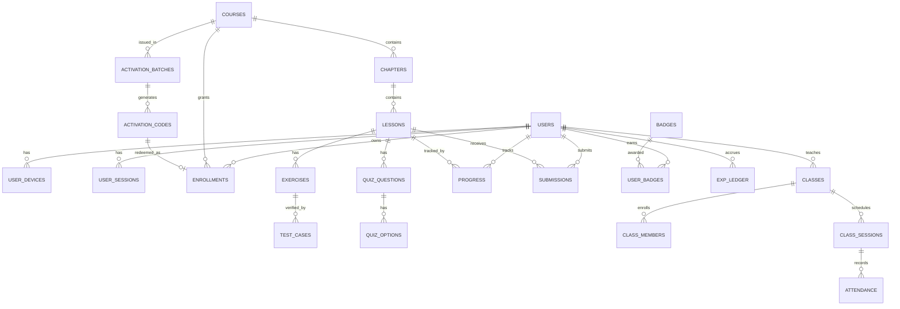

# Minh Trí Academy — Kiến trúc hệ thống & Thiết kế bảo mật

> Phạm vi: Phần 1 (Kiến trúc + DB) và Phần 2 (Luồng Activation Code). Phần 3 (prototype) nằm tại `web/`.
> Quy ước: **[Quyết định]** = lựa chọn thiết kế đã chốt theo trao đổi; **[Giả định]** = cần xác nhận lại.

---

## 1. Kiến trúc tổng thể

### 1.1 Tech Stack (đã chốt)

| Tầng | Lựa chọn | Lý do chính |
|---|---|---|
| Frontend | **Next.js 15 (App Router) + React 19 + Tailwind** | SSR/SSG cho trang công khai (SEO lead-gen), CSR cho LMS/IDE |
| Editor | **Monaco Editor** (`@monaco-editor/react`) | Tooling gần VS Code; hỗ trợ Python/Java/C++ |
| Backend | **NestJS (TypeScript)**, modular monolith | RBAC bằng Guards/Decorators; một ngôn ngữ với FE; tách module → có thể tách service sau |
| Database | **PostgreSQL 16** | Ràng buộc toàn vẹn (CHECK, UNIQUE, FK), JSONB cho nội dung bài học |
| Cache/Queue | **Redis 7** + **BullMQ** | Rate limit, heartbeat phiên học, hàng đợi chấm bài |
| Code Execution | **Sandbox cô lập** (Judge0 CE hoặc Piston, self-host) | Không chạy code người dùng trong process của API |
| Python client-side | **Pyodide** (WASM) | Chạy Python ngay trên trình duyệt cho bài đơn giản → giảm tải server |
| Scratch | **scratch-blocks / Blockly** + VM giả lập | Thực thi block ở client |
| Media | Video qua **Cloudflare Stream / Mux** (signed URL, TTL ngắn) | Không tự host video |
| Auth | JWT access (15’) + refresh rotation; Google OAuth | Xem §3 |

### 1.2 Sơ đồ thành phần



**Module NestJS:** `auth`, `users`, `catalog` (course/chapter/lesson), `activation`, `enrollment`, `learning` (progress/quiz), `grading`, `gamification`, `classroom` (class/attendance/notes), `leads`, `analytics`, `audit`.

### 1.3 Ma trận phân quyền (RBAC + ownership)

| Tài nguyên | Visitor | Student | Teacher | Admin |
|---|:-:|:-:|:-:|:-:|
| Trang công khai, gửi `leads` | ✓ | ✓ | ✓ | ✓ |
| Nội dung bài học | – | Chỉ khóa có `enrollment` active | Khóa của lớp mình phụ trách | ✓ |
| Nộp bài / xem điểm | – | Của mình | Học viên trong lớp mình | ✓ |
| Chấm tay, nhận xét, điểm danh | – | – | Lớp mình | ✓ |
| CRUD khóa học/bài học | – | – | – | ✓ |
| Sinh/thu hồi Activation Code | – | – | – | ✓ |
| Khóa/mở tài khoản, dashboard | – | – | – | ✓ |

Enforce hai lớp: (1) `@Roles()` guard; (2) **ownership check trong query** (`WHERE class.teacher_id = :me`) — tránh IDOR, không chỉ dựa vào role.

### 1.4 ERD

Schema đầy đủ: [`db/schema.sql`](../db/schema.sql).



Điểm thiết kế đáng lưu ý:

- **`activation_codes.code_hmac`**: lưu HMAC-SHA256 với *pepper* phía server, không lưu plaintext. Admin chỉ thấy mã đầy đủ **một lần** lúc sinh (CSV tải về); sau đó chỉ có `code_hint` (4 ký tự cuối).
- **`enrollments.code_id UNIQUE`** + **`UNIQUE(user_id, course_id)`**: DB tự chặn một mã dùng hai lần và một học viên ghi danh trùng khóa — không phụ thuộc logic ứng dụng.
- **`exp_ledger` append-only, `UNIQUE(user_id, reason, ref_id)`**: cộng EXP idempotent (retry/double-click không cộng đúp); `users.exp_total` chỉ là cache.
- **Hint/Solution tách ở `exercises`**, trả về qua endpoint riêng (xem §2.4).
- **`lessons.content` là JSONB**: linh hoạt theo `type`, có thể thêm trường mà không migrate.

---

## 2. Luồng bảo mật & xử lý Activation Code

### 2.1 Định dạng mã

`MTA-XXXX-XXXX-XXXX`: **11 ký tự dữ liệu + 1 ký tự kiểm tra = 12 ký tự** Crockford Base32 (bỏ I, L, O, U), ≈ **55 bit entropy**. *(Bản trước ghi "12 ký tự + 1 checksum ≈ 60 bit", không khớp định dạng hiển thị 12 ký tự; đã sửa theo định dạng. Brute-force trực tuyến vẫn không khả thi: với 10⁶ mã hợp lệ, xác suất một lần đoán trúng ≈ 3·10⁻¹¹.)* Chuẩn hóa (upper-case, bỏ khoảng trắng và dấu `-`, bỏ tiền tố `MTA`, ánh xạ `O→0`, `I/L→1`) trước khi HMAC.

Ký tự kiểm tra dùng **Luhn mod 32**: phát hiện 100% lỗi sai một ký tự (đã kiểm chứng vét cạn trong unit test) và hầu hết lỗi đảo hai ký tự liền kề (> 95%, không phải 100%). Sai checksum → 422, **không chạm DB và không tính vào bộ đếm thất bại**. Mã gắn với `hmac_key_id` để xoay pepper (cấu hình `ACTIVATION_PEPPERS="id:hex,…"`, khóa đầu là khóa hiện hành; khóa cũ giữ lại cho tới khi hết mã cũ).

### 2.2 Sinh mã (Admin)

1. Admin chọn khóa, số lượng, hạn dùng, (tùy chọn) email gắn sẵn → tạo `activation_batches`.
2. Server sinh mã bằng CSPRNG, tính `code_hmac`, insert `activation_codes` (`status='unused'`), ghi `audit_logs`.
3. Trả file CSV chứa plaintext **một lần**. Không thể truy xuất lại.

### 2.3 Kích hoạt mã (Student) — `POST /v1/activate`

*(Đã hiện thực tại `api/src/activation/`; đường dẫn đổi từ `/activation/redeem` thành `/activate`.)*

```text
Preconditions: đã đăng nhập (JWT); email_verified = true (tài khoản trẻ em do phụ huynh quản lý: đối chiếu email phụ huynh)
1. Rate limit (Redis, cửa sổ trượt) — chỉ đếm lần THẤT BẠI, kiểm tra TRƯỚC khi xử lý:
     theo user: 5 thất bại / 15’     theo IP: 100 thất bại / giờ (IP thuộc mạng tin cậy của trung tâm: ×10)
     vượt ngưỡng → 429 + Retry-After, kể cả khi mã đúng (mã không bị tiêu hao)
2. Chuẩn hóa + kiểm tra checksum; sai → 422 CODE_FORMAT_INVALID (không chạm DB, không tính bộ đếm)
3. BEGIN;
   SELECT … FROM activation_codes WHERE code_hmac = ANY($hmac_của_mọi_pepper) FOR UPDATE;   -- khóa hàng, chống race
4. Kiểm tra:
     đã dùng bởi CHÍNH user này           → 409 ALREADY_REDEEMED_BY_YOU (không tính bộ đếm)
     không tồn tại / đã dùng bởi người khác / bị thu hồi / hết hạn (ghi status='expired', COMMIT)
       / bound_email không khớp           → bộ đếm thất bại +1 → 404 CODE_INVALID (CÙNG status & body cho mọi lý do)
5. SAVEPOINT; SELECT grant_access($user, $course, 'code', $code_id);              -- migration 002
   -- cùng transaction: đánh dấu mã 'used'; tạo enrollment lần đầu HOẶC gia hạn (cộng từ max(now, expires_at));
   -- ghi sổ cái enrollment_grants; progress/submissions giữ nguyên (enrollments là 1 hàng / (user, course)).
   -- Lỗi nghiệp vụ (sau khi mã & email đã hợp lệ, KHÔNG đốt mã, KHÔNG tính bộ đếm):
   --   NO_ENROLLMENT_TO_EXTEND (mã gia hạn nhưng chưa có khóa) → 409;  ALREADY_LIFETIME (khóa vĩnh viễn) → 409
6. COMMIT; xóa cache quyền truy cập khóa học; ghi audit 'code.redeem' (không bao giờ chứa mã).
```

Hai tính chất được kiểm chứng bằng test tích hợp trên PostgreSQL/Redis thật: (a) hai người cùng dùng một mã → đúng một người thắng; (b) một người dùng hai mã của cùng khóa đồng thời → một enrollment, hai lần cấp (lần sau là gia hạn).

**Quyết định về ràng buộc 1-1:** nếu admin gắn sẵn email → bắt buộc khớp. Nếu không gắn sẵn → mã *bind vào tài khoản đầu tiên redeem* (`redeemed_by`) và không thể dùng lại. Ràng buộc `UNIQUE(code_id)` nay nằm ở `enrollment_grants`: 1 mã ↔ 1 lần cấp quyền; `enrollments` giữ `UNIQUE(user_id, course_id)` nên mỗi học viên vẫn chỉ có một enrollment mỗi khóa, và gia hạn không làm mất tiến độ. Tài khoản do phụ huynh quản lý (`users.is_managed`) đối chiếu `bound_email` với email của người giám hộ. Các quy tắc đầy đủ: [`DECISIONS.md`](DECISIONS.md) (ADR-002, ADR-003).

**Cấp thủ công (admin):** `grant_access(..., 'admin_grant', p_admin => ...)` — dùng cho học viên đóng học phí trực tiếp tại trung tâm; bắt buộc ghi `granted_by` và `audit_logs`.

**Phản hồi thống nhất:** *mọi* lý do thất bại liên quan tới mã (không tồn tại, sai email, đã dùng bởi người khác, bị thu hồi, hết hạn) trả cùng một mã HTTP 404 và cùng nội dung — sửa bất nhất của bản trước vốn liệt kê 404/403/409/410 khác nhau, tạo oracle dò trạng thái mã. Lý do thật chỉ nằm trong `audit_logs`. Ngoại lệ có chủ đích: người dùng dùng lại mã *của chính mình* nhận 409 riêng (không lộ thông tin về người khác).

### 2.4 Kiểm soát truy cập nội dung

Mỗi request nội dung kiểm tra bằng Guard (tham chiếu `can_access_lesson`): `enrollment.status='active' AND (expires_at IS NULL OR expires_at > now())`, **hoặc** chương có `is_free_preview` và người dùng đã đăng nhập + xác minh email (học thử Chương 1 của Scratch và Python). Cache Redis TTL ngắn, xóa chủ động khi thu hồi/hết hạn. Video dùng **signed URL TTL 5–10 phút**, gắn `session_id`.

Gợi ý và lời giải **không nằm trong payload bài học**:
- `POST /exercises/:id/hints/:level` (level 1→3, tuần tự, không phạt EXP) — hàm `open_hint`.
- `GET /exercises/:id/solution` — hàm `view_solution`: mở khi ≥ 3 lần nộp sai (mã nguồn khác nhau) **hoặc** ≥ 10 phút làm bài tích lũy (heartbeat), **hoặc** đã đạt. Xem lời giải *trước khi đạt* → EXP bài học còn 50% (`lesson_exp_award`).
- Accordion ở UI chỉ là lớp hiển thị, không phải lớp bảo mật.

### 2.5 Chống chia sẻ tài khoản — **[Quyết định]** mức "code↔email + giới hạn phiên/thiết bị"

**Nhận xét phản biện:** ràng buộc code↔email chỉ chặn việc *chia sẻ mã*. Học viên vẫn có thể đưa mật khẩu cho người khác. Do đó bổ sung:

| Cơ chế | Chi tiết |
|---|---|
| **Giới hạn thiết bị** | Mặc định **3 thiết bị**/tài khoản (`users.device_quota`, admin có thể nâng tới 5 cho trường hợp đặc biệt). Thiết bị = cookie ngẫu nhiên httpOnly, **không dùng fingerprint** (tránh rủi ro riêng tư, đặc biệt với trẻ em). Vượt giới hạn → buộc thu hồi thiết bị cũ qua trang quản lý thiết bị (xác thực email OTP). **Máy kiosk của trung tâm** (`institution_devices`, do admin đăng ký, chỉ hợp lệ khi IP thuộc `trusted_networks`) không tính vào quota. |
| **Trung tâm (IP/NAT)** | Dải IP của trung tâm được đánh dấu *Trusted Institution* (`trusted_networks`): nới rate limit theo IP (redeem, đăng nhập) để nhiều học viên dùng chung NAT. Chỉ áp dụng cho IP tĩnh độc quyền, không áp dụng cho CGNAT. Miễn quota thiết bị yêu cầu thêm yếu tố thứ hai là máy kiosk đã đăng ký. |
| **Gia đình** | Mỗi bé có tài khoản riêng (`is_managed`, không cần email) liên kết với phụ huynh (`guardian_links`); phụ huynh chuyển hồ sơ sang con (`user_sessions.acting_guardian_id`). Tiến độ, EXP, phiên học và quota thiết bị tách theo từng bé. |
| **1 phiên học đồng thời** | Client gửi heartbeat 30s vào Redis key `learn:{userId}`; phiên thứ hai vào học → phiên cũ nhận `409 SESSION_SUPERSEDED` và bị đẩy ra (`revoked_reason='new_session_kick'`). |
| **Refresh-token rotation + reuse detection** | Mỗi lần refresh phát token mới, token cũ vô hiệu. Token cũ bị dùng lại ⇒ cả `family_id` bị thu hồi (dấu hiệu token bị sao chép). |
| **Phát hiện bất thường** | Chấm điểm rủi ro: đổi quốc gia/ASN trong thời gian ngắn, > N thiết bị mới/tuần, nhiều IP khác dải. Vượt ngưỡng → yêu cầu OTP lại + cảnh báo admin (không khóa tự động). |
| **Mật khẩu** | argon2id, kiểm tra mật khẩu bị lộ (k-anonymity HIBP), rate limit đăng nhập. |
| **Phụ huynh** | Tài khoản trẻ em: email giám hộ nhận thông báo đăng nhập thiết bị mới. |

**Giới hạn còn lại (trung thực):** không thể chặn tuyệt đối việc người dùng *cùng nhà* chia sẻ chung thiết bị. Mục tiêu là nâng chi phí chia sẻ đáng kể, không phải loại bỏ 100%. Watermark video/fingerprint đã được loại khỏi phạm vi theo lựa chọn của bạn.

### 2.6 Bảo mật nền tảng

- Mọi chấm code chạy ở **sandbox không mạng**, giới hạn CPU/RAM/thời gian/số process; worker **không** nằm cùng mạng với DB.
- CSP nghiêm ngặt (Monaco/Pyodide nạp từ CDN cần whitelist hoặc self-host).
- Validation đầu vào (class-validator/zod), parameterized query, CSRF cho cookie-based refresh, SameSite=Lax/Strict.
- Audit log cho: sinh/thu hồi mã, khóa user, chấm điểm tay, đổi role.
- Dữ liệu trẻ em: tối thiểu hóa dữ liệu (`birth_year` thay vì ngày sinh), consent phụ huynh, tuân thủ Nghị định 13/2023/NĐ-CP về bảo vệ dữ liệu cá nhân **[Cần bổ sung nguồn — xác nhận với pháp chế]**.

---

## 3. Thiết kế Online IDE (mức prototype → production)

| Ngôn ngữ | Prototype (`web/app/ide`) | Production |
|---|---|---|
| Python | **Pyodide thực thi thật** trên trình duyệt (stdout/stderr) | Pyodide cho chạy thử; **chấm bài** luôn qua sandbox server |
| Java / C++ | **Mock** có đánh dấu rõ ràng | Sandbox tự vận hành (Piston/Judge0/runner `isolate`, chốt sau benchmark) qua BullMQ; xem [`GRADING_PIPELINE.md`](GRADING_PIPELINE.md) |
| Scratch | Trình xem block giả lập (SVG tĩnh + "chạy" mô phỏng sprite) | `scratch-blocks` + `scratch-vm` |

Luồng chấm: `Submit → INSERT submissions(pending) → BullMQ → Worker gọi sandbox với từng test_case → ghi result JSONB, score → cộng EXP (idempotent) → đánh giá badge rule`. Client **không bao giờ** là nguồn tin cậy cho điểm số.

---

## 4. Điểm cần xác nhận

1. **[Giả định]** Thanh toán diễn ra ngoài hệ thống (chuyển khoản → admin cấp mã). Nếu cần cổng thanh toán (VNPay/MoMo), thêm module `orders` và tự động sinh mã.
2. **[Giả định]** `duration_days` mặc định `NULL` (truy cập vĩnh viễn) — cần chốt chính sách hết hạn. *Gia hạn* đã được hỗ trợ (ADR-002); khóa vĩnh viễn không gia hạn.
3. ~~Chính sách mở Lời giải~~ → **Đã chốt** (ADR-001). Prototype `/ide`, `/learn` vẫn "mở tự do" để minh họa UX.
4. ~~Hạn mức thiết bị cho gia đình~~ → **Đã chốt** (ADR-003): tài khoản riêng cho từng bé + liên kết phụ huynh.

Các quyết định đã chốt và các điểm còn cần xác nhận: [`DECISIONS.md`](DECISIONS.md).
