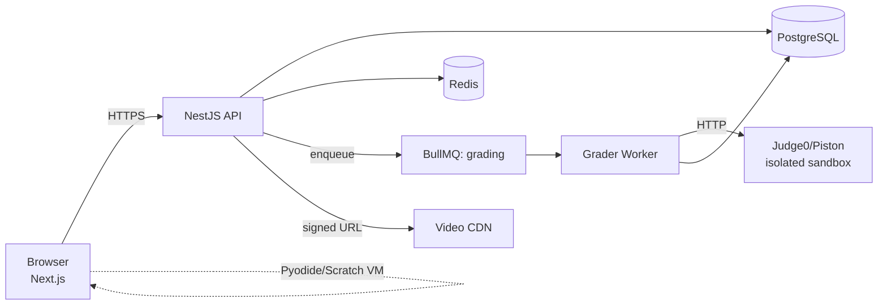
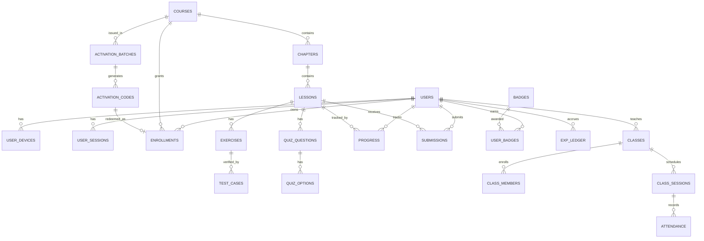

# Minh Trí Academy — Kiến trúc hệ thống & Thiết kế bảo mật

> Phạm vi: Phần 1 (Kiến trúc + DB) và Phần 2 (Luồng Activation Code). Phần 3 (prototype) nằm tại `web/`.
> Quy ước: **[Quyết định]** = lựa chọn thiết kế đã chốt theo trao đổi; **[Giả định]** = cần xác nhận lại.

---

## 1. Kiến trúc tổng thể

### 1.1 Tech Stack (đã chốt)

| Tầng | Lựa chọn | Lý do chính |
|---|---|---|
| Frontend | **Next.js 15 (App Router) + React 19 + Tailwind** | SSR/SSG cho trang công khai (SEO lead-gen), CSR cho LMS/IDE |
| Editor | **Monaco Editor** (`@monaco-editor/react`) | Tooling gần VS Code; hỗ trợ Python/Java/C++ |
| Backend | **NestJS (TypeScript)**, modular monolith | RBAC bằng Guards/Decorators; một ngôn ngữ với FE; tách module → có thể tách service sau |
| Database | **PostgreSQL 16** | Ràng buộc toàn vẹn (CHECK, UNIQUE, FK), JSONB cho nội dung bài học |
| Cache/Queue | **Redis 7** + **BullMQ** | Rate limit, heartbeat phiên học, hàng đợi chấm bài |
| Code Execution | **Sandbox cô lập** (Judge0 CE hoặc Piston, self-host) | Không chạy code người dùng trong process của API |
| Python client-side | **Pyodide** (WASM) | Chạy Python ngay trên trình duyệt cho bài đơn giản → giảm tải server |
| Scratch | **scratch-blocks / Blockly** + VM giả lập | Thực thi block ở client |
| Media | Video qua **Cloudflare Stream / Mux** (signed URL, TTL ngắn) | Không tự host video |
| Auth | JWT access (15’) + refresh rotation; Google OAuth | Xem §3 |

### 1.2 Sơ đồ thành phần



**Module NestJS:** `auth`, `users`, `catalog` (course/chapter/lesson), `activation`, `enrollment`, `learning` (progress/quiz), `grading`, `gamification`, `classroom` (class/attendance/notes), `leads`, `analytics`, `audit`.

### 1.3 Ma trận phân quyền (RBAC + ownership)

| Tài nguyên | Visitor | Student | Teacher | Admin |
|---|:-:|:-:|:-:|:-:|
| Trang công khai, gửi `leads` | ✓ | ✓ | ✓ | ✓ |
| Nội dung bài học | – | Chỉ khóa có `enrollment` active | Khóa của lớp mình phụ trách | ✓ |
| Nộp bài / xem điểm | – | Của mình | Học viên trong lớp mình | ✓ |
| Chấm tay, nhận xét, điểm danh | – | – | Lớp mình | ✓ |
| CRUD khóa học/bài học | – | – | – | ✓ |
| Sinh/thu hồi Activation Code | – | – | – | ✓ |
| Khóa/mở tài khoản, dashboard | – | – | – | ✓ |

Enforce hai lớp: (1) `@Roles()` guard; (2) **ownership check trong query** (`WHERE class.teacher_id = :me`) — tránh IDOR, không chỉ dựa vào role.

### 1.4 ERD

Schema đầy đủ: [`db/schema.sql`](../db/schema.sql).



Điểm thiết kế đáng lưu ý:

- **`activation_codes.code_hmac`**: lưu HMAC-SHA256 với *pepper* phía server, không lưu plaintext. Admin chỉ thấy mã đầy đủ **một lần** lúc sinh (CSV tải về); sau đó chỉ có `code_hint` (4 ký tự cuối).
- **`enrollments.code_id UNIQUE`** + **`UNIQUE(user_id, course_id)`**: DB tự chặn một mã dùng hai lần và một học viên ghi danh trùng khóa — không phụ thuộc logic ứng dụng.
- **`exp_ledger` append-only, `UNIQUE(user_id, reason, ref_id)`**: cộng EXP idempotent (retry/double-click không cộng đúp); `users.exp_total` chỉ là cache.
- **Hint/Solution tách ở `exercises`**, trả về qua endpoint riêng (xem §2.4).
- **`lessons.content` là JSONB**: linh hoạt theo `type`, có thể thêm trường mà không migrate.

---

## 2. Luồng bảo mật & xử lý Activation Code

### 2.1 Định dạng mã

`MTA-XXXX-XXXX-XXXX`: 12 ký tự Crockford Base32 (≈60 bit entropy) + 1 ký tự checksum. Chuẩn hóa (upper-case, bỏ dấu `-`, ánh xạ `O→0`, `I/L→1`) trước khi HMAC. Checksum giúp loại sớm lỗi gõ nhầm **mà không chạm DB** và không tính vào bộ đếm thất bại.

### 2.2 Sinh mã (Admin)

1. Admin chọn khóa, số lượng, hạn dùng, (tùy chọn) email gắn sẵn → tạo `activation_batches`.
2. Server sinh mã bằng CSPRNG, tính `code_hmac`, insert `activation_codes` (`status='unused'`), ghi `audit_logs`.
3. Trả file CSV chứa plaintext **một lần**. Không thể truy xuất lại.

### 2.3 Kích hoạt mã (Student) — `POST /v1/activation/redeem`

```text
Preconditions: user đã đăng nhập + email_verified = true
1. Rate limit (Redis): 5 lần/15’/user và 20 lần/giờ/IP → 429
2. Validate checksum; sai → 422 (không tính vào bộ đếm)
3. BEGIN;
   SELECT * FROM activation_codes WHERE code_hmac = $1 FOR UPDATE;   -- khóa hàng, chống race
4. Kiểm tra theo thứ tự:
     không tồn tại          → tăng bộ đếm thất bại (Redis) → 404 (thông báo chung "Mã không hợp lệ")
     status ≠ 'unused'      → 409  (used/revoked/expired)
     expires_at < now()     → UPDATE status='expired' → 410
     bound_email ≠ NULL AND bound_email ≠ user.email → 403
       (log audit 'code.redeem_email_mismatch'; phản hồi ra ngoài vẫn là thông báo chung)
     đã có enrollment (user, course) → 409
5. UPDATE activation_codes SET status='used', redeemed_by=$user, redeemed_at=now();
   INSERT INTO enrollments (user_id, course_id, code_id, expires_at, price_paid_vnd) ...;
6. COMMIT; invalidate cache quyền truy cập khóa học.
```

**Quyết định về ràng buộc 1-1:** nếu admin gắn sẵn email → bắt buộc khớp. Nếu không gắn sẵn → mã *bind vào tài khoản đầu tiên redeem* (`redeemed_by`) và không thể dùng lại. Cả hai đều đảm bảo 1 mã ↔ 1 tài khoản ↔ 1 enrollment (ràng buộc UNIQUE ở DB).

**Phản hồi thống nhất:** các trường hợp "không tồn tại / sai email" trả cùng thông điệp để không cho kẻ tấn công dò trạng thái mã (enumeration oracle). Lý do thật được ghi vào `audit_logs` cho admin.

### 2.4 Kiểm soát truy cập nội dung

Mỗi request nội dung kiểm tra `enrollment.status='active' AND (expires_at IS NULL OR expires_at > now())` bằng Guard, cache Redis TTL ngắn. Video dùng **signed URL TTL 5–10 phút**, gắn `session_id`. Lời giải (`solution_md`) **không nằm trong payload bài học**; chỉ trả qua `GET /exercises/:id/solution` khi thỏa chính sách (ví dụ đã nộp ≥ 1 lần hoặc đã bấm xem gợi ý) — Accordion ở UI chỉ là lớp hiển thị, không phải lớp bảo mật.

### 2.5 Chống chia sẻ tài khoản — **[Quyết định]** mức "code↔email + giới hạn phiên/thiết bị"

**Nhận xét phản biện:** ràng buộc code↔email chỉ chặn việc *chia sẻ mã*. Học viên vẫn có thể đưa mật khẩu cho người khác. Do đó bổ sung:

| Cơ chế | Chi tiết |
|---|---|
| **Giới hạn thiết bị** | Tối đa **3 thiết bị** đã đăng ký/tài khoản (`user_devices`). Thiết bị = cookie ngẫu nhiên httpOnly, **không dùng fingerprint** (tránh rủi ro riêng tư, đặc biệt với trẻ em). Vượt giới hạn → buộc thu hồi thiết bị cũ qua trang quản lý thiết bị (xác thực email OTP). |
| **1 phiên học đồng thời** | Client gửi heartbeat 30s vào Redis key `learn:{userId}`; phiên thứ hai vào học → phiên cũ nhận `409 SESSION_SUPERSEDED` và bị đẩy ra (`revoked_reason='new_session_kick'`). |
| **Refresh-token rotation + reuse detection** | Mỗi lần refresh phát token mới, token cũ vô hiệu. Token cũ bị dùng lại ⇒ cả `family_id` bị thu hồi (dấu hiệu token bị sao chép). |
| **Phát hiện bất thường** | Chấm điểm rủi ro: đổi quốc gia/ASN trong thời gian ngắn, > N thiết bị mới/tuần, nhiều IP khác dải. Vượt ngưỡng → yêu cầu OTP lại + cảnh báo admin (không khóa tự động). |
| **Mật khẩu** | argon2id, kiểm tra mật khẩu bị lộ (k-anonymity HIBP), rate limit đăng nhập. |
| **Phụ huynh** | Tài khoản trẻ em: email giám hộ nhận thông báo đăng nhập thiết bị mới. |

**Giới hạn còn lại (trung thực):** không thể chặn tuyệt đối việc người dùng *cùng nhà* chia sẻ chung thiết bị. Mục tiêu là nâng chi phí chia sẻ đáng kể, không phải loại bỏ 100%. Watermark video/fingerprint đã được loại khỏi phạm vi theo lựa chọn của bạn.

### 2.6 Bảo mật nền tảng

- Mọi chấm code chạy ở **sandbox không mạng**, giới hạn CPU/RAM/thời gian/số process; worker **không** nằm cùng mạng với DB.
- CSP nghiêm ngặt (Monaco/Pyodide nạp từ CDN cần whitelist hoặc self-host).
- Validation đầu vào (class-validator/zod), parameterized query, CSRF cho cookie-based refresh, SameSite=Lax/Strict.
- Audit log cho: sinh/thu hồi mã, khóa user, chấm điểm tay, đổi role.
- Dữ liệu trẻ em: tối thiểu hóa dữ liệu (`birth_year` thay vì ngày sinh), consent phụ huynh, tuân thủ Nghị định 13/2023/NĐ-CP về bảo vệ dữ liệu cá nhân **[Cần bổ sung nguồn — xác nhận với pháp chế]**.

---

## 3. Thiết kế Online IDE (mức prototype → production)

| Ngôn ngữ | Prototype (`web/app/ide`) | Production |
|---|---|---|
| Python | **Pyodide thực thi thật** trên trình duyệt (stdout/stderr) | Pyodide cho chạy thử; **chấm bài** luôn qua sandbox server |
| Java / C++ | **Mock** có đánh dấu rõ ràng | Judge0/Piston qua BullMQ: `POST /submissions` → job → poll/WebSocket |
| Scratch | Trình xem block giả lập (SVG tĩnh + "chạy" mô phỏng sprite) | `scratch-blocks` + `scratch-vm` |

Luồng chấm: `Submit → INSERT submissions(pending) → BullMQ → Worker gọi sandbox với từng test_case → ghi result JSONB, score → cộng EXP (idempotent) → đánh giá badge rule`. Client **không bao giờ** là nguồn tin cậy cho điểm số.

---

## 4. Điểm cần xác nhận

1. **[Giả định]** Thanh toán diễn ra ngoài hệ thống (chuyển khoản → admin cấp mã). Nếu cần cổng thanh toán (VNPay/MoMo), thêm module `orders` và tự động sinh mã.
2. **[Giả định]** `duration_days` mặc định `NULL` (truy cập vĩnh viễn) — cần chốt chính sách hết hạn.
3. Chính sách mở **Lời giải**: sau ≥ 1 lần nộp, hay sau N lần sai? Prototype dùng "mở tự do" để minh họa UX.
4. Hạn mức 3 thiết bị / 1 phiên đồng thời có phù hợp với gia đình có nhiều con học chung? Cân nhắc loại tài khoản "gia đình".
