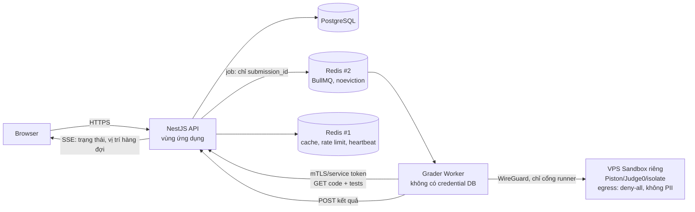

# Minh Trí Academy — Pipeline chấm bài, Sandbox & Năng lực hệ thống

> Phạm vi: ADR-004 (sandbox tự vận hành) và ADR-005 (tải đỉnh, độ trễ). Xem [`DECISIONS.md`](DECISIONS.md).
> **[D]** = dữ kiện/thiết kế đã chốt · **[S]** = suy luận/ước lượng, **bắt buộc đo lại bằng benchmark §4–§5 trước khi chốt phần cứng**.
> Không có số liệu nào dưới đây là kết quả đo thực nghiệm.

## 1. Kiến trúc & vùng tin cậy



Quyết định chính:
- **Worker không có quyền DB** (sửa mâu thuẫn trong sơ đồ gốc: `Worker → PG`). Job trong Redis chỉ chứa `submission_id`; worker lấy mã nguồn + bộ test (kể cả test ẩn) từ endpoint nội bộ của API, rồi gửi kết quả về API; **API là bên duy nhất ghi DB, cộng EXP (transaction, idempotent) và phát sự kiện**.
- **Hai Redis tách biệt:** hàng đợi (BullMQ yêu cầu `maxmemory-policy noeviction`) và cache/rate limit/heartbeat (cho phép evict). Tránh cache đẩy mất job hoặc job làm đầy cache.
- **Sandbox chỉ nhận** `(ngôn ngữ, mã nguồn, stdin, giới hạn)`. Không tên, email, ID người dùng.

## 2. Vòng đời một lần nộp bài

```text
1. POST /v1/submissions  { exercise_id, language, code, idempotency_key }
   - Guard: can_access_lesson; kích thước ≤ 64 KB; rate limit: 10 lần/phút/user, 1 job đang chạy / (user, exercise)
   - Trùng idempotency_key → trả submission cũ (không tạo mới)
2. INSERT submissions(state='pending', code_sha256, queued_at=now())
3. Cache: nếu đã có kết quả cho (test_set_hash, code_sha256) → ghi lại ngay, bỏ qua sandbox
4. BullMQ.add(queue = "grade:<lang_class>", jobId = submission_id, attempts = 2 chỉ cho system_error)
5. Worker lấy job → GET /internal/grading/:id → chạy sandbox: biên dịch 1 lần (compile_limit_ms),
   chạy lần lượt test (time_limit_ms, memory_limit_kb), so khớp theo compare_mode
6. POST /internal/grading/:id/result  { verdict, per-test verdicts, runtime, memory, test_set_hash, started_at }
7. API (1 transaction): UPDATE submissions(state, score, result, verdict, started_at, finished_at);
   nếu đạt → UPDATE exercise_attempts.passed_at; cộng EXP = lesson_exp_award(...) qua exp_ledger (idempotent);
   đánh giá badge; phát SSE
```

Máy trạng thái: `pending → auto_graded | needs_review | graded`. `system_error` (sandbox lỗi/quá tải) **không tính là lần sai** của học viên (xem view `v_solution_eligibility`) và được thử lại tối đa một lần.

Chỉ số đo SLO có sẵn trong DB: hàng đợi = `started_at − queued_at`; chấm = `finished_at − started_at`; tổng = `finished_at − queued_at`.

## 3. Mô hình năng lực (suy luận định lượng)

**Công thức.** Với N bài nộp *đồng thời* (FIFO), C lõi chấm, W giây CPU cho mỗi bài: bài thứ k hoàn tất sau ≈ k·W/C, nên

> p95 ≈ 0,95 · N · W / C (cộng thêm thời gian chạy tối thiểu của một bài)

Với nộp **trải đều** (λ yêu cầu/giây) bài toán là hàng đợi nhiều máy phục vụ (M/M/c); khi mức sử dụng ρ = λW/C đủ thấp, p95 ≈ thời gian phục vụ.

**Giả định W [S]** (cho bộ 5 test; cần đo): Python ≈ 0,5 s (khởi động trình thông dịch + isolate × 5); C++ ≈ 1,3 s (biên dịch ≈ 1,2 s, chạy nhanh, *giả định biên dịch một lần*); Java ≈ 3,0 s (javac + JVM × 5). Nếu biên dịch lặp lại cho từng test, W của C++/Java tăng khoảng ×3–5.

**Kịch bản A — cả lớp nộp đồng thời, N = 50:** (thời gian p95 ≈ 0,95·50·W/C)

| Lõi chấm C | Python (W=0,5) | C++ (W=1,3) | Java (W=3,0) |
|---:|---:|---:|---:|
| 8 | 3,0 s | 7,7 s | 17,8 s |
| 12 | 2,0 s | 5,1 s | 11,9 s |
| 16 | 1,5 s | 3,9 s | 8,9 s |

**Kịch bản B — trải đều trong 60 s (λ ≈ 0,83/s):** ρ = λW/C. Với C = 4: Python ρ ≈ 0,10 (p95 ≈ thời gian phục vụ, < 1 s); C++ ρ ≈ 0,27; Java ρ ≈ 0,62 và p95 khoảng 7 s dưới giả định phân phối phục vụ dạng mũ (hàng đợi M/M/4 tính tay) [S].

**Kết luận [S]:**
1. p95 < 2 s với **Python** khả thi trên ≈ 12 lõi cho cả kịch bản nộp đồng thời; trong kịch bản trải đều chỉ cần ≈ 4 lõi.
2. p95 < 2 s với **Java** không khả thi theo mô hình này vì thời gian phục vụ một bài (≈ 3 s) đã vượt mục tiêu; chỉ có thể tiến gần nếu chạy các test song song và biên dịch một lần (ước ≈ 1,6 s mỗi bài).
3. Cấu hình khởi điểm hợp lý cho thử nghiệm: **VPS 8–16 vCPU, RAM ≥ 16 GB** [S], số slot sandbox = số lõi − 1; chốt sau benchmark.

Các đòn bẩy giảm W, N: "Chạy thử" Python ở client (Pyodide trong Worker); cache kết quả theo `(test_set_hash, code_sha256)` (bài chép chung cả lớp); thoát sớm khi lỗi biên dịch; pool JVM ấm; các test chạy song song khi dư lõi.

## 4. Chọn engine sandbox — spike 1–2 ngày

**Giả thuyết [S], chưa kiểm chứng:** Piston đơn giản hơn (không cần DB/Redis riêng) nhưng mỗi lần gọi là một lần chạy; Judge0 có batch nhưng nặng hơn (Postgres + Redis + workers) và từng có advisory thoát sandbox **[Cần bổ sung nguồn: số CVE, phiên bản vá]**; runner mỏng tự viết trên `isolate` cho kiểm soát cao nhất (biên dịch một lần, chạy N test) nhưng tốn công bảo trì.

| Tiêu chí | Cách đo | Ngưỡng chấp nhận |
|---|---|---|
| Độ trễ 1 bài, 5 test (rảnh) | 200 lần, mỗi ngôn ngữ | p95 theo bảng ADR-005 |
| Biên dịch một lần / chạy N test | Đếm số lần gọi compiler | Đúng 1 lần / bài |
| Thông lượng | Kịch bản A và B (§5) | Đạt SLO trên cấu hình ứng viên |
| Cô lập | Bộ độc hại §5.3 | 100% bị chặn đúng verdict, không ảnh hưởng host |
| Yêu cầu đặc quyền / cgroup | Đọc tài liệu + thử trên OS định dùng | Ghi rõ, có kế hoạch giảm thiểu **[Cần kiểm chứng]** |
| Vận hành | Số thành phần, nâng cấp, quan sát | Một người vận hành được |

## 5. Kế hoạch kiểm thử tải & an toàn

1. **Tải (k6 hoặc tương đương)**
   - A: 50 nộp trong 5 s; B: 50 trải đều 60 s; C: 30 trải đều + 1 đợt 20 đồng thời.
   - Tỷ lệ ngôn ngữ ban đầu: 70% Python, 20% C++, 10% Java (điều chỉnh theo khóa học thực tế).
   - Báo cáo: p50/p95/p99 tổng, thời gian hàng đợi, tỷ lệ lỗi, độ sâu hàng đợi tối đa.
2. **Chịu lỗi:** tắt Redis hàng đợi giữa chừng, tắt worker, tắt sandbox; kỳ vọng: không mất bài nộp (đã có `submissions.pending`), có cơ chế quét lại bài `pending` quá hạn, người dùng thấy trạng thái rõ ràng.
3. **Bộ chương trình độc hại (kỳ vọng verdict + host nguyên vẹn):** vòng lặp vô hạn, fork bomb, cấp phát bộ nhớ vô hạn, in output khổng lồ, `#include` file đặc biệt / template đệ quy (compile bomb), mở kết nối mạng, ghi/đọc ngoài thư mục làm việc, đọc `/proc`, `ptrace`, tạo nhiều file/đầy đĩa.
4. **Chống lạm dụng:** rate limit theo user và theo `trusted_networks` (nới theo IP trung tâm), giới hạn đồng thời `1 job / (user, exercise)`, chặn khi hàng đợi vượt ngưỡng (trả `429` + `Retry-After`), SSE hiển thị vị trí hàng đợi.

## 6. Cấu hình BullMQ khởi điểm [D thiết kế, giá trị cần chỉnh theo §5]

- Hàng đợi theo lớp ngôn ngữ (`grade:python`, `grade:compiled`) để tác vụ nặng không chặn nhẹ; tổng concurrency = số slot sandbox, chia sẻ theo trọng số.
- `jobId = submission_id` (loại trùng), `attempts = 2` **chỉ** cho `system_error` với backoff ngắn; sai đáp án/lỗi biên dịch không thử lại.
- Timeout cứng theo job = `compile_limit_ms + Σ time_limit_ms + biên độ`; `removeOnComplete` giữ ngắn; dead-letter queue + cảnh báo.
- Giới hạn độ sâu hàng đợi (ví dụ 200 job chờ) để chủ động từ chối thay vì để độ trễ tăng vô hạn.
- Quan sát: độ sâu hàng đợi, `started_at − queued_at`, tỷ lệ `system_error`, số slot đang bận, tuổi bài `pending` lâu nhất.
